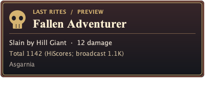

# Last Rites

Achievement-style death announcements for Old School RuneScape's Hardcore Worlds.



- Pop-ups show the player, final hit, reported killer and region when supplied.
- Missing causes stay unlabelled. The plugin does not guess at weather, agility,
  poison, or other causes from missing information.
- Alt-drag a pop-up to move it. **Position preview** keeps a sample visible while
  positioning; RuneLite remembers the overlay's position in the selected profile.
- Full integer broadcast totals are preserved. Abbreviated totals can be enriched
  through Jagex's **Hardcore Main** HiScores table. These values are explicitly
  labelled **HiScores** and retain the broadcast value alongside them: a lookup
  may lag or reflect a subsequent reset. Unavailable lookups keep the broadcast.
- Regex exclusions can match the original broadcast or named fields. Open the
  skull sidebar to save filters, view recent deaths, preview the pop-up, or report a bug.

This is a working development prototype, not a published Plugin Hub release.
It recognises the verified broadcast formats documented in [the implementation
notes](docs/IMPLEMENTATION.md). New Jagex formats are ignored until verified.

## Try it locally

From the parent workspace:

```sh
./plugin check Last-Rites
./plugin gradle Last-Rites build
./plugin run Last-Rites
```

Or independently from this repository: `./gradlew check build` and `./gradlew run`.
Java 11 is the compilation target; development is tested on macOS with JDK 21.
The launcher registers Last Rites with `ExternalPluginManager.loadBuiltin` before
starting RuneLite. It uses RuneLite's existing profiles and credential handling.
No credential file is copied or read by the plugin or workspace tooling.

Enable **Last Rites** in the normal Plugins panel. Click its skull icon, then
**Show sample death** or **Toggle position preview**. Live announcements require
a Hardcore world. The sample never makes a HiScores request or enters history.

## Filters

Put one regex per line in **Hide matching deaths**, or use the sidebar editor.
Matching is case insensitive, and a match anywhere excludes that death.

| Example | Excludes |
| --- | --- |
| `\btotal=33\b` | Exactly total 33, not 330 |
| `\btotal=(33\|34)\b` | Total 33 or 34 |
| `killer=.*Goblin` | A reported killer containing Goblin |
| `player=Example Name\b` | A named player |
| `damage=0\b` | A zero-damage final hit |

Named fields are `player`, `total`, `broadcastTotal`, `damage`, `killer`, and
`location`. `total` uses a full HiScores value once available; `broadcastTotal`
always retains the server text. Missing `killer`/`location` values are empty.
Filters apply before lookups and are checked again when a full total arrives.
An announcement already displayed may therefore be removed after enrichment.

Filters use [RE2/J](https://github.com/google/re2j): ordinary regex alternation,
groups, anchors, character classes and word boundaries work. Lookarounds and
backreferences are unsupported. Invalid rules are identified by line in the
sidebar; valid rules continue working. Limits: 32 rules, 512 characters per rule.

## Private bug reports

**Report a bug** opens the native form used by IRL XP. No account, email, or
contact address is required. Reports use the same HTTPS receiver and private
developer inbox, with a `[Last Rites]` title prefix so the plugin is identifiable.
The developer's private destination is not exposed by the client or responses.

You review the exact text and confirm before sending. Optional technical details
contain only reporting revision, OS name, Java version, and RuneLite version.
Logs, screenshots, account information, death history, and player names are not
attached automatically. Leave personal information out of free text.

Drafts are saved locally in RuneLite's `last-rites` directory, outside synced
configuration. Sending saves a recovery copy. Retrying an unchanged report reuses
its reference; editing creates a new one. Acceptance confirms durable queueing,
not final delivery into GitHub. Delivered receiver copies expire after 30 days;
private issues and host backups have separate retention.

Railway processes connection metadata including IP addresses. The receiver does
not store IP addresses or include them in issues. This is optional private
reporting, not a fully anonymous communications service.

The portable reporting package is included in this repository and has no build
dependency on IRL XP or the parent workspace. See [reuse instructions](docs/REPORTING.md).

## Validation and rollout

Tests cover observed death formats, blank causes, exact/abbreviated totals, regex
rules and errors, queueing/enrichment, rendering, overlay position restoration,
server-channel/world gating, HiScores outcomes, report payload privacy, retry
receipts, and draft/window recreation. HTTP transport tests use interceptors and
do not send reports to the real inbox.

Before publishing: validate additional live server formats, test on multiple
client sizes, obtain Plugin Hub review including RE2/J and the shared reporting
endpoint, and add this repository's release/submission workflow. Publishing is
separate from creating and pushing this development repository.
